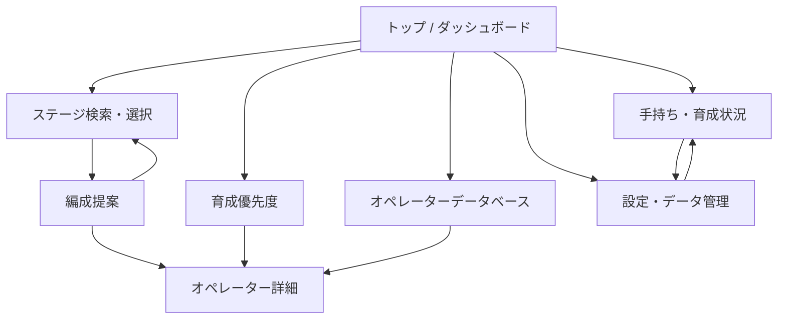

# アークナイツ編成シミュレーター 設計書

## 1. 目的と対象範囲

手持ちオペレーター、育成状況、ステージ情報をローカルで照合し、編成候補と育成優先度を説明付きで提示する静的Webアプリを設計する。まず「手持ち登録」と「育成優先度」を成立させ、続いてステージ別編成提案、最後にオペレーター情報閲覧を拡張する。編成・ランキングは説明可能なルールベースとし、AI推論やサーバーAPI、ユーザーアカウントは導入しない。

### 前提と非目標

- Vanilla JavaScript + ES Modules、HTML、CSSで実装し、ビルド工程やフレームワークは持たない。
- オペレーターとステージのマスターデータは同梱JSONから読み込む。ユーザーの所持・育成データだけをLocalStorageに保存する。
- 初期データの内容は手動で整備し、オペレーター/ステージ情報の参照候補である [PRTS Wiki](https://prts.wiki/) 等の出典・確認日・ゲーム内バージョンを記録する。スクレイピング/APIによる自動取得は行わない。
- スコアは候補を比較するための目安であり、唯一の正解やゲーム内の勝率を保証しない。画面に評価要因を表示し、重みは後から調整可能にする。
- GitHub Pagesのプロジェクトページ配下への配置を前提とし、ルート絶対パスに依存しない。

## 2. 情報設計と画面遷移



アプリは単一ページで、ヘッダーのナビゲーションから各ビューを切り替える。URLフラグメント（例: `#roster`、`#stages`）をビュー状態に同期し、戻る/進む操作やリンク共有時の再表示に対応する。選択中ステージは `#proposal/<stage-id>` のように識別する。データ初期化またはマスターデータの読込に失敗した場合は、画面遷移を有効にする前に原因と再試行方法を表示する。

## 3. 画面・UIコンポーネント

### 共通シェル

- **ヘッダー**: アプリ名、主要ナビゲーション、手持ち登録数、データ管理への導線。
- **メイン領域**: 選択中ビューを一つ表示。切替時に見出しへフォーカスを移し、現在位置を読み上げ可能にする。
- **共通状態**: 初期読込中、JSON読込エラー、データなし、検索結果なし、LocalStorage保存失敗を、対象領域内に説明と操作可能な再試行/復旧手段付きで表示。
- **共通オペレーターカード**: 名前、レアリティ、職業/職分、昇進・レベル等、必要に応じてスコアと採用理由を表示。カード全体を操作要素にする場合はボタンまたはリンクとして実装する。

### トップ / ダッシュボード

- 手持ち概要: 登録人数、レアリティや職業別の簡易内訳、保存状態。
- クイックアクション: オペレーター登録、ステージから編成、育成ランキングへ移動。
- 育成候補上位と、主要役割の不足サマリーを表示。手持ちが空なら登録を促し、スコアを誤表示しない。

### 手持ち・育成状況

- 検索入力（名前オートコンプリート）、レアリティ・職業・職分のフィルター、所持/未所持の表示切替。
- オペレーター一覧をカードまたは一覧で表示。個別編集領域で所持状態、昇進段階、レベル、スキルレベル、特化段階、モジュール装備を入力する。
- 保存は入力確定時に行い、登録数と保存完了を通知する。削除時は確認し、キャンセル可能にする。
- 絞り込み条件に該当するデータがない場合は「所持なし」と「検索該当なし」を区別する。

### ステージ検索・編成提案

- カテゴリ（メインストーリー、殲滅作戦、イベント、危機契約等）、章/イベント、ステージ名、難度/Phaseで検索・絞り込み。
- ステージ詳細にカテゴリ、Phase、敵構成、ギミック、要求役割、配置メモを表示する。PhaseのないモードではPhase欄を省略する。
- 実行ボタンから所持オペレーターを評価し、12枠以下で編成候補を提示。枠の番号を配置順の目安として表示するが、厳密なマップ配置とは区別する。
- 各候補に採用理由、適合した敵/ギミック、スコア内訳を表示する。各枠の代替候補と、選択中オペレーターを外す操作を提供する。
- 12名に満たない場合は不足枠を空欄のままにし、役割不足を説明する。所持登録がない場合は先に手持ち登録へ誘導する。

### 育成優先度

- 全所持オペレーターを対象に、昇進2・スキル特化・モジュール等の育成アクション単位で候補を表示する。
- 順位、総合点、汎用性、手持ちの役割補完、素材負担、推奨アクションと判断理由を表示。
- 職業/職分の不足フィルターと、評価重みを確認できる説明領域を設ける。空の手持ちには登録導線を表示する。
- 素材データが欠けている場合、コストをゼロと誤認させず「算出対象外」と表示する。

### オペレーターデータベース / 詳細

- 名前検索、レアリティ、職業、職分による絞り込み。
- 詳細に基本ステータス、スキル、素質、モジュール、育成素材、タグ/役割を表示。
- シナジーは双方の条件と期待される効果をデータに基づき記述する。未登録情報は推測せず非表示または未登録とする。

### 設定・データ管理

- 所持・育成データをJSONでエクスポート/インポート、全データの初期化。
- エクスポート前に含まれる情報を説明する。インポートは形式・バージョン・operator IDを検証し、プレビュー後にユーザー確認を得てから反映する。
- 不正データは保存前に拒否し、現在のデータを保持してエラー箇所を説明する。
- データ初期化は確認画面を挟み、取り消せないことを明示する。
- マスターデータのゲームバージョン、更新日、データ出典を表示する。

## 4. ディレクトリ構成

```text
arknights-team-builder/
├── index.html
├── favicon.svg
├── og-image.png
├── css/
│   ├── base.css
│   ├── layout.css
│   ├── components.css
│   └── responsive.css
├── js/
│   ├── main.js
│   └── modules/
│       ├── app-state.js
│       ├── navigation.js
│       ├── data-loader.js
│       ├── storage.js
│       ├── roster.js
│       ├── stages.js
│       ├── recommendation.js
│       ├── scoring.js
│       ├── growth-advisor.js
│       ├── database.js
│       ├── import-export.js
│       └── ui.js
├── data/
│   ├── operators.json
│   ├── stages.json
│   └── scoring-config.json
└── docs/
    └── design.md
```

`index.html` は意味構造のある領域、ナビゲーション、各ビューの枠、metaタグ、ES Module入口を定義する。CSSは基礎スタイル、ページ配置、再利用部品、画面幅対応の責務に分ける。`main.js` が初期化を行い、`modules/` はデータ取得、ユーザー状態、ドメイン計算、ビュー操作に分離する。画面ファイルを機能ごとに多数作らず、ビュー単位でDOM領域を再利用する。`data/` のマスターデータは読み取り専用で、ユーザー状態を混在させない。

### モジュール責務とデータ処理順

1. `data-loader.js` が `fetch(new URL('../data/operators.json', import.meta.url))` 等の相対URLでJSONを取得し、必須項目・ID重複・参照整合性を検証する。
2. `storage.js` がLocalStorageからスキーマバージョン付きユーザーデータを読み、必要なら移行する。読み込み不能時は空データで上書きせず、復旧案内を出す。
3. `app-state.js` がマスターデータ、手持ち、検索条件、選択ビューを保持し、更新通知を発行する。
4. `roster.js` / `stages.js` が検索・フィルター対象を作る。`scoring.js` / `recommendation.js` / `growth-advisor.js` は純粋関数として候補評価を行う。
5. `ui.js` および各機能モジュールが状態からDOMを描画する。ユーザー入力は検証して状態更新し、保存後に必要な領域だけ再描画する。

## 5. オペレーターマスターデータ (`data/operators.json`)

トップレベルに `schemaVersion`、`gameVersion`、`updatedAt`、`source`、`operators` を持たせる。`id` は表示名と分離した不変識別子とし、ユーザーの所持データやステージ内参照はIDで結ぶ。表示名の変更・表記揺れで所持データが壊れないようにする。

```json
{
  "schemaVersion": 1,
  "gameVersion": "更新対象のバージョン",
  "updatedAt": "YYYY-MM-DD",
  "source": "参照元と確認日",
  "operators": [
    {
      "id": "example-operator",
      "name": "例示オペレーター",
      "rarity": 6,
      "class": "Sniper",
      "subclass": "Marksman",
      "skills": [
        {
          "id": "skill-1",
          "name": "スキル名",
          "description": "効果の説明",
          "spType": "auto",
          "spCost": 0,
          "duration": 0,
          "masteryEffects": ["特化時の変化"]
        }
      ],
      "talents": [
        { "name": "素質名", "description": "効果の説明", "unlock": "解放条件" }
      ],
      "modules": [
        {
          "id": "module-id",
          "name": "モジュール名",
          "trait": "特性変化",
          "stages": [{ "stage": 1, "description": "強化内容", "materials": [] }]
        }
      ],
      "stats": {
        "base": { "hp": 0, "atk": 0, "def": 0, "res": 0, "redeployTime": 0, "cost": 0, "block": 0, "attackInterval": 0 },
        "promotion": [{ "phase": 1, "maxLevel": 0, "stats": { "hp": 0, "atk": 0, "def": 0, "res": 0 } }]
      },
      "materials": {
        "promotion": [{ "phase": 1, "items": [{ "itemId": "item-id", "quantity": 0 }] }],
        "skills": [],
        "mastery": [],
        "modules": []
      },
      "tags": ["対空", "単体火力"],
      "synergies": [{ "operatorId": "other-operator-id", "reason": "相互作用の説明" }]
    }
  ]
}
```

| キー | 型 | 必須 | 内容・検証 |
|---|---|---:|---|
| `id` | string | 必須 | 一意で不変のID。英小文字・数字・ハイフンを基本とする。 |
| `name` | string | 必須 | 表示名。検索用の正規化値は必要に応じて実行時生成する。 |
| `rarity` | integer | 必須 | 1〜6の範囲。 |
| `class` | string | 必須 | 職業。表記はアプリ内の共通値に統一する。 |
| `subclass` | string | 必須 | 職分。職業との組合せを検証する。 |
| `skills` | array | 必須 | スキルID、名前、説明、SP情報、持続時間、特化差分。 |
| `talents` | array | 必須 | 素質名、効果、解放条件。未実装値は空配列を使う。 |
| `modules` | array | 必須 | モジュールID、名称、特性、段階別効果・素材。 |
| `stats` | object | 必須 | 基礎値および昇進/レベルごとの値。未整備項目を0で補わず、任意値として扱う。 |
| `materials` | object | 必須 | 昇進、スキル、特化、モジュール別のアイテムIDと必要数。 |
| `tags` | string[] | 必須 | 編成・不足役割計算に使う正規化済み能力タグ。 |
| `synergies` | array | 必須 | 相手のIDと関係の説明。存在しないIDを検証で検出する。 |

`skills` の昇進条件など、データ化が難しい項目は初期スキーマに無理に追加せず、必要な機能と更新元が決まった段階でバージョンを上げる。JSONは実際に確認できたデータのみ収録し、上記例は構造を示すプレースホルダーである。

## 6. ステージマスターデータ (`data/stages.json`)

ステージは基本情報と `phases` の配列に分ける。Phaseごとに敵、ギミック、推奨役割、配置メモを持てるようにし、Phaseを持たないステージは一つの標準要素を設定する。ステージIDは不変値とする。

```json
{
  "schemaVersion": 1,
  "gameVersion": "更新対象のバージョン",
  "updatedAt": "YYYY-MM-DD",
  "source": "参照元と確認日",
  "stages": [
    {
      "id": "chapter-stage-id",
      "name": "ステージ名",
      "category": "main",
      "chapter": "章またはイベント名",
      "order": 1,
      "phases": [
        {
          "id": "normal",
          "name": "通常",
          "recommendedRoles": [
            { "role": "anti_air", "weight": 1.0, "reason": "飛行敵への対応" }
          ],
          "enemyTags": ["flying", "armored"],
          "mechanics": [
            { "id": "mechanic-id", "name": "ギミック名", "description": "影響の説明", "requiredRoles": ["healing"] }
          ],
          "deploymentNotes": ["序盤に配置コストを確保する"]
        }
      ]
    }
  ]
}
```

| キー | 型 | 内容・検証 |
|---|---|---|
| `id` | string | 一意なステージID。 |
| `name` | string | 表示用ステージ名。 |
| `category` | enum string | `main`、`annihilation`、`event`、`contingency` 等の既定値。未知値はフォールバック表示する。 |
| `chapter` | string | 章・イベント名。カテゴリ検索や一覧グルーピングに使う。 |
| `order` | number | 同一カテゴリ内の表示順。未設定時は名称順にする。 |
| `phases` | array | Phase ID・表示名・敵タグ・推奨役割・ギミック・配置メモ。 |
| `recommendedRoles` | array | 正規化された役割タグ、重要度 `weight` (0〜1)、推奨理由。 |
| `mechanics.requiredRoles` | string[] | ギミックに対する必要役割。存在する役割タグか検証する。 |

Phase名やゲーム上の難易度区分はモードごとに違い得るため、JSON値をそのまま表示し、表示側に固定の難度推測を埋め込まない。敵データが不十分な場合でも、編集者が登録した役割タグと説明だけで提案可能とする。

## 7. 編成提案・育成優先度スコア

### 共通ルール

- 入力タグは `anti_air`、`healing`、`slow`、`burst_damage`、`defense`、`arts_damage`、`lane_hold` 等の辞書に正規化する。
- 候補ごとに0〜100の部分スコアを算出する。データ不足は中立値で偽装せず、利用可能項目だけで重みを再正規化し、欠損情報を結果に表示する。
- 重みは `data/scoring-config.json` に置き、画面処理から分離する。初期値を調整できるよう設定値の説明と更新日を記録する。
- スコアは優先候補を探す補助情報である。表示には合計値だけでなく正の寄与、減点、データ不足を含める。

### ステージ編成スコア

所持オペレーター `o` と選択ステージPhase `p` に対する初期適合度:

```text
baseFit(o, p) = 0.45 × roleMatch(o, p)
              + 0.30 × mechanicMatch(o, p)
              + 0.15 × enemyMatch(o, p)
              + 0.10 × readiness(o)
```

各部分値は0〜100に正規化する。`roleMatch` は `tags` と `recommendedRoles` の一致度を重要度付きで評価し、`mechanicMatch` はギミックの `requiredRoles` 対応、`enemyMatch` は敵タグへの有効性を評価する。`readiness` は昇進・レベル・スキル・特化などユーザーが登録した育成状態の適合度であり、編成上の役割適合を覆さないよう低い比重にする。

選出は次の貪欲手順を使い、同じ役割に偏りすぎないよう編成全体の被覆ボーナスを適用する。

1. 候補は所持登録済みオペレーターに限定する。
2. 0〜12名の範囲で、未充足の重要役割を最も改善する候補を順次追加する。
3. 選出ごとに適合度へ `coverageBonus` を加算する。未充足役割との一致を加点し、すでに充足した役割だけの重複を逓減する。重要度の高い役割に多重対応できる候補は重複でも選出可能とする。
4. 追加による改善がなく、かつ必須役割が充足したら終了する。候補が少ない場合は最大12名に達するまで可能性を評価するが、低適合者を埋め草として強制追加しない。
5. 同点時は未充足重要役割数、適合度、ユーザーの育成状態、オペレーターIDの順に決定し、結果を再現可能にする。
6. 手動で候補を入れ替えた場合は自動提案と区別し、手動変更を再計算で黙って破棄しない。

採用理由は「対空タグがPhase推奨役割に一致」「ギミック対応タグを所持」など、部分スコアの根拠を短文に変換して表示する。代替候補は同一または近接役割を担い、元候補より低い全体カバー損失となる候補を優先する。

### 育成優先度スコア

育成アクション `a`（例: 昇進2、特化、モジュール）ごとに次を計算する。

```text
growthScore(o, a) = 0.40 × versatility(o, a)
                  + 0.35 × rosterGapFit(o, a)
                  + 0.15 × stageCoverage(o, a)
                  + 0.10 × readinessBenefit(o, a)
                  - 0.20 × normalizedCost(o, a)
```

全項を0〜100に正規化し、最終値は0〜100に丸める。`versatility` はタグが有効となる登録済みステージの割合、`rosterGapFit` は所持全体で不足する役割の補完度、`stageCoverage` は重要ステージ群での役割適合度、`readinessBenefit` は現在の育成段階からアクション完了で得られる増分を表す。`normalizedCost` は素材マスターデータが揃うときに、必要素材の相対負担を評価する。負の重みを含むため、最後に `clamp(0, 100, ...)` を適用する。

最初はマスターデータの網羅性が低い可能性があるため、欠損値の項目を除外して残りの正の重みを再正規化し、コスト評価を利用できない場合は「コスト未評価」と明記する。値が小さいほど優先度が上がる素材量の逆スケールを0〜100の負担点に変換する。ランキングはオペレーター単位でなく育成アクション単位とし、次に行う具体的作業を示す。同点時は役割不足改善、コスト低、ID順とする。

### スコア設定例

`data/scoring-config.json` は `schemaVersion`、`teamWeights`、`growthWeights`、役割辞書、`updatedAt` を持つ。重みの合計値や上下限を読込時に検証し、壊れている場合はコード内の安全な既定値を使って警告を出す。スコア変更後は、代表的なステージと複数の役割構成を使い、説明理由と順位の変化を手動確認する。

## 8. ユーザーデータ、保存、プライバシー

LocalStorageキーはアプリ名空間とバージョンを含める。

- `arknights-team-builder:user:v1`: `schemaVersion`、`updatedAt`、`roster`、ユーザー設定。
- `arknights-team-builder:prefs:v1`: 最後に開いたビュー、フィルター等、再構築可能な表示設定。
- 保存する所持情報は `operatorId`、`owned`、`promotionPhase`、`level`、`skillLevels`、`masteryLevels`、`moduleLevels` に限定する。
- JSONマスターデータはLocalStorageへ複製せず、アプリ配布物から毎回読み込む。
- LocalStorageは同一ブラウザー内の保存であり、端末間同期やバックアップを保証しない旨を設定画面に表示する。
- 保存容量超過・プライベートブラウズ等の例外を捕捉し、未保存状態をユーザーに通知する。保存失敗時に成功表示をしない。
- インポートJSONはサイズ制限を設け、型、ID、数値範囲、重複、バージョンを検証する。未知のoperator IDは削除せずプレビューで提示し、適用時に保持/除外を選択できる。

## 9. HTML/CSS/JavaScript実装方針

### 静的SPAとES Modules

`index.html` を唯一のHTML入口とし、`<script type="module" src="./js/main.js">` で初期化する。モジュールは依存方向を `main → feature modules → data/storage/scoring utilities` に保ち、相互循環importを作らない。DOM更新はイベント委譲を基本とし、入力値・JSON由来文字列を `innerHTML` へ直接連結しない。表示テキストは `textContent` 等で設定する。

GitHub Pages上で `file://` 直接起動した場合はJSON取得が制限されるため、ローカルHTTPサーバーまたはGitHub Pagesで確認するよう開発手順に記す。サイトのベースパスを決め打ちせず、HTML参照は相対URL、モジュール内データ参照は `import.meta.url` 基準で構築する。

### ビュー表示とCSS

- ビュー切替はJavaScriptが対象領域の `hidden` プロパティとURLフラグメントを同期し、CSSクラスの重ね合わせで隠す状態を増やさない。
- `hidden` 属性の標準動作を上書きしない。共通リセットに `[hidden] { display: none !important; }` を置き、`.is-hidden` と属性を競合させない。
- 動的ダイアログ等は状態クラスを必要最小限にし、開閉時にフォーカス移動、Escape閉じ、背景操作制限、`aria-expanded` 等を同期する。
- まず1列の読みやすいレイアウトを実装し、640pxを主なレイアウト切替点として一覧/カード列数、ナビゲーション、フィルター配置を調整する。640px以上のスマートフォン幅を必須の検証範囲に含め、狭い画面でも横スクロールを強制せず主要操作を利用可能にする。
- キーボード操作、フォーカス可視化、色だけに依存しない評価表示、画像代替テキスト、適切な見出し階層を確保する。

### ブラウザー・運用条件

現行の主要モダンブラウザーでES Modules、Fetch、LocalStorageを利用する。ネットワークは静的ファイルの初回取得以外に不要。マスターデータはアプリ更新で配布し、ゲーム更新後はデータの出典・確認日を再確認してJSONを手動更新する。JSON更新時はschemaVersion、参照ID、タグ辞書、スコア変化をまとめて確認する。

## 10. 公開・メタデータ

- `index.html` に日本語の `title`、説明用 `meta description`、`theme-color`、favicon、OGPの `og:title`、`og:description`、`og:type`、`og:url`、`og:image`、`twitter:card` を設定する。
- OGP画像URLは公開後に解決できるHTTPS URLにする。GitHub Pagesのリポジトリ名を含むサブパスを考慮し、相対リンクと絶対OGP URLを使い分ける。
- `favicon.svg` と `og-image.png` は公開アセットとして用意し、リポジトリに存在しない参照先を残さない。
- GitHub Pagesの公開元をブランチ/ディレクトリに設定し、HTTPSを有効にする。追加ビルドや秘密情報は不要。
- リポジトリの内容を一般公開する前提で、配布データの出典と利用条件を確認し、第三者の画像・文章を無断転載しない。ユーザーデータを外部送信しない。

## 11. 受け入れ・検証観点

1. `index.html` をHTTP経由で開き、オペレーターJSON・ステージJSONの読込成功と読込失敗時の説明を確認する。
2. 各ビューへの遷移、フラグメント更新、ブラウザー戻る/進む、詳細への遷移を確認する。
3. 手持ちの追加・編集・削除後に再読込してもデータが保持され、LocalStorageを消去した場合に空状態が適切に出ることを確認する。
4. 不正JSON、未知ID、重複ID、範囲外の昇進/スキル値をインポートし、元データを壊さず理由を表示することを確認する。
5. ステージPhaseごとの役割一致、12名上限、役割重複抑制、同点時の再現性、12名未満の編成、理由と代替候補を確認する。
6. 育成優先度の役割不足反映、素材欠損時の扱い、評価アクション別ランキング、説明可能な加点/減点を確認する。
7. 640px幅以上のスマートフォン表示と狭幅表示、タッチ操作、キーボード操作、フォーカス、エラー/空状態を確認する。
8. GitHub PagesのプロジェクトサブパスでJSON、CSS、JavaScript、favicon、OGP画像が404にならず、metaタグが解決可能であることを公開前に確認する。

## 12. 実装優先順

1. データスキーマ、初期JSON、ES Module初期化、LocalStorage、手持ち登録、育成優先度を実装する。
2. ステージ検索、Phaseデータ、説明付きルールベース編成、代替候補を追加する。
3. 詳細データベース、シナジー閲覧、インポート/エクスポートとマスターデータ更新手順を整える。
4. レスポンシブ/アクセシビリティ確認、OGP・favicon、GitHub Pagesサブパス検証を完了して公開する。

この順序により、手持ち登録だけでも価値を提供できる段階を先に確立し、後続機能は同じマスターデータ・タグ辞書・役割スコアを再利用して重複実装を避ける。
