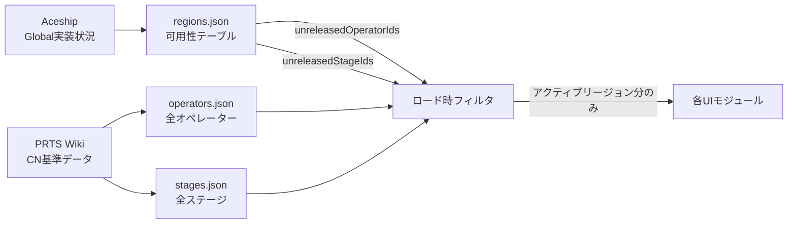
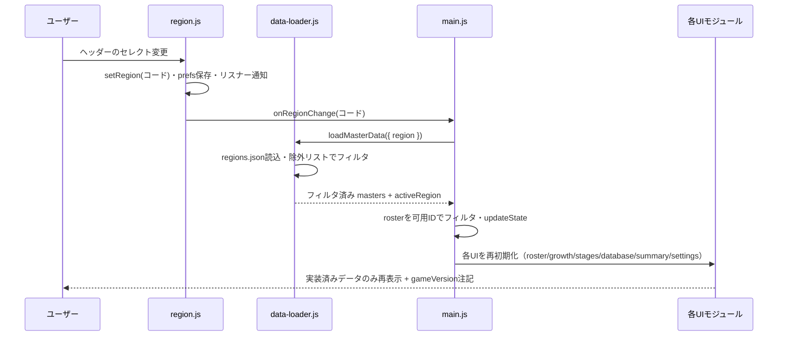

# アークナイツ編成シミュレーター リージョン切替機能 設計書

> 対象バージョン: 現行 `main`（operators.json schemaVersion 2 / stages.json schemaVersion 1）
> 位置づけ: 大陸版（CN）とグローバル版（Global）のリージョン切替を追加するための設計。

## 0. 概要と前提

### 0.1 目的

ユーザーが自分のプレイしているリージョン（大陸版 CN / グローバル版 Global）を選択し、**そのリージョンで実装済みのオペレーター・ステージのみ**を編成・育成・閲覧の対象とする。

### 0.2 確定した方針（本設計の前提）

- **リージョンと言語は独立設定**。CN を選択しても表示言語を `ja` にできる（逆も同様）。
- **データ出典**: オペレーター/ステージのCN基準データは PRTS Wiki（既存出典を継続）。グローバル版のリリース順・ゲーム内バージョン・実装状況は Aceship を参照し、最終的に手動入力で確定する。
- **実装方式は「案A」**：トップレベルにリージョン可用性テーブルを追加し、ロード時にアクティブリージョンでフィルタする。マスターデータは既にCN準拠の単一ソースなので、これを維持する。
- 自動スクレイピングや外部APIは導入しない（既存方針 `docs/design.md` と同様）。

### 0.3 リージョンとバージョンの関係

CN は常に最新で、Global は約半年遅れで追随する。したがって **CN が全データのスーパーセット（参照元）、Global はその部分集合**となる。Global にのみ存在するデータは原則ない。この性質を利用し、全件データを列挙しつつ「各リージョンでまだ未実装の ID」を**除外リスト**として持つ方式を採る。



---

## 1. データ構造の変更仕様

### 1.1 全体方針（単一ソース + 除外リスト）

- マスターデータ（`operators.json` / `stages.json`）の各レコードは **CN基準のまま変更しない**。
- リージョン差分は **専用の可用性テーブル** に「未実装IDのリスト」として集約する。
- レコードごとに `availability: { cn, global }` を持たせる方式（案B）は採用しない。理由は、ほぼ全オペレーターに属性を付与する手間と、新オペ追加時に全レコードへ記入漏れが起きるリスクを避けるため。除外リストなら「Global に未実装のもの」だけを明示すればよい。

### 1.2 新設ファイル `data/regions.json`（リージョン可用性テーブル）

可用性テーブルはオペレーターIDとステージIDの**両方**を参照する横断メタデータであるため、`operators.json` 内に埋め込むと `operators.json` がステージIDに依存する不自然な結合になる。専用ファイルとして分離する。

```json
{
  "schemaVersion": 1,
  "defaultRegion": "cn",
  "updatedAt": "2026-10-30",
  "source": "PRTS Wiki (CN reference data); Aceship (Global release order and game version) reviewed manually.",
  "regions": {
    "cn": {
      "code": "cn",
      "isReference": true,
      "gameVersion": "2.7.71",
      "unreleasedOperatorIds": [],
      "unreleasedStageIds": []
    },
    "global": {
      "code": "global",
      "isReference": false,
      "gameVersion": "2.5.xx",
      "unreleasedOperatorIds": [
        "operator-id-not-yet-in-global",
        "..."
      ],
      "unreleasedStageIds": [
        "stage-id-not-yet-in-global",
        "..."
      ]
    }
  }
}
```

フィールド定義:

| フィールド | 型 | 必須 | 説明 |
|---|---|---|---|
| `schemaVersion` | number | 必須 | 可用性テーブル自身の形式バージョン。初期値 `1`。 |
| `defaultRegion` | string | 必須 | 初期起動時（未設定時）に使うリージョン。`"cn"`。 |
| `updatedAt` / `source` | string | 任意 | 既存マスター同様の整備履歴・出典。 |
| `regions` | object | 必須 | リージョンコード→可用性情報のマップ。 |
| `regions.<code>.code` | string | 必須 | `"cn"` / `"global"`。`regions` のキーと一致させる。 |
| `regions.<code>.isReference` | boolean | 必須 | CN基準データそのものか。`cn` のみ `true`。 |
| `regions.<code>.gameVersion` | string | 必須 | そのリージョンのゲーム内バージョン（例 `"2.7.71"`）。 |
| `regions.<code>.unreleasedOperatorIds` | string[] | 必須 | そのリージョンで未実装のオペレーターID。`cn` は常に `[]`。 |
| `regions.<code>.unreleasedStageIds` | string[] | 必須 | そのリージョンで未実装のステージID。`cn` は常に `[]`。 |

制約:

- リージョンコードは `data-loader.js` 側の `supportedRegions` と一致させる。
- `unreleasedOperatorIds` / `unreleasedStageIds` は `operators.json` / `stages.json` に実在するIDのみを記載する（後述の検証で担保）。
- 将来リージョンを増やす場合（例: 韓国版 `kr`、台湾版 `tw`）は `regions` にキーを1つ追加するだけでよい。

### 1.3 `data/operators.json` への変更

| 項目 | 現状 | 変更後 | 理由 |
|---|---|---|---|
| 各オペレーターrecord | 不変 | **不変** | 除外リスト方式のためレコード形状を変えない。 |
| トップレベル `gameVersion`（`"CN 2.7.71"`） | あり | **削除（regions.jsonへ移行）** | バージョンはリージョンごとに異なるため、可用性テーブルに集約して重複管理をやめる。 |
| `schemaVersion` | `2` | **`2` のまま** | record形状・必須キーに変更がないため据え置き。 |

追加で各オペレーターに持たせるフィールドは **ない**。

### 1.4 `data/stages.json` への変更

| 項目 | 現状 | 変更後 | 理由 |
|---|---|---|---|
| 各ステージrecord | 不変 | **不変** | 同上。 |
| トップレベル `gameVersion` | なし | **追加しない** | バージョンは `regions.json` に集約（欠落の解消もこれで行う）。 |
| `schemaVersion` | `1` | **`1` のまま** | record形状に変更がないため据え置き。 |

### 1.5 `data/i18n.json` への追加キー

表示ラベルは既存の翻訳基盤（`i18n.json` + `localizeMasterValue`）に載せる。`ja` / `zh-CN` / `ko` / `en` の4言語ブロックすべてに追加する。

```json
{
  "ja": {
    "region.label": "リージョン",
    "region.cn": "大陸版 (CN)",
    "region.global": "グローバル版 (Global)",
    "region.hint": "実装済みのオペレーター・ステージのみを表示します。言語設定とは独立しています。",
    "region.gameVersion": "ゲーム内バージョン",
    "region.changed": "リージョンを切り替えました（{{gameVersion}}）。",
    "region.unreleasedHidden": "このリージョンで未実装の {{operators}} 名・{{stages}} ステージを非表示にしています。"
  }
}
```

### 1.6 `schemaVersion` の更新方針（まとめ）

| ファイル | 現行 | 変更後 | 変更内容 |
|---|---|---|---|
| `data/operators.json` | 2 | **2** | record不変。`gameVersion` を削除（regions.jsonへ）。 |
| `data/stages.json` | 1 | **1** | record不変。 |
| `data/regions.json` | — | **1（新規）** | 新設。 |
| `data/scoring-config.json` | 1 | 1 | 変更なし。 |
| `data/i18n.json` | — | — | `region.*` キーを4言語分追加（バージョン管理対象外）。 |
| LocalStorage `prefs` | — | — | `region` フィールド追加（キー不変・後方互換）。 |
| LocalStorage `user` | 1 | 1 | roster形式不変。リージョンで内容は変えない。 |

方針: **schemaVersion を上げるのは「既存レコードの形状が変わる」または「旧データが壊れる」場合のみ**。除外リスト方式はレコード不変なので、既存ファイルのバージョンをむやみに上げない。

---

## 2. UI設計

### 2.1 ヘッダーへのリージョンスイッチャー配置

`index.html` の `.site-header` 内、既存の設定リンク（`.settings-link`）の直前にリージョン選択を配置する。言語選択は現状どおり設定ビュー（`#language-select`）に残し、リージョンは常時見えるヘッダーに置く。

```html
<header class="site-header">
  <!-- 既存 brand / primary-nav -->
  <label class="region-field">
    <span class="region-label" data-i18n="region.label">リージョン</span>
    <select id="region-select" name="region" aria-describedby="region-hint">
      <option value="cn" data-i18n="region.cn">大陸版 (CN)</option>
      <option value="global" data-i18n="region.global">グローバル版 (Global)</option>
    </select>
  </label>
  <a class="settings-link" href="#settings" data-view-link="settings" data-i18n="nav.settings">設定</a>
</header>
```

- オプションはハードコードせず、`regions.json` の `regions` から動的生成する（将来のリージョン追加に追従）。
- 選択変更時に `region.changed`（ゲーム内バージョン付き）をフィードバック表示する。
- 概要（ダッシュボードの `#master-summary`）と設定画面に、現在のリージョンと `gameVersion`、および `region.unreleasedHidden` による「非表示件数」の注記を出す。

### 2.2 言語設定との独立性

- リージョンは `prefs.region`、言語は `prefs.language` と**別フィールド**で保存する（`storage.js` の `loadPreferences`/`savePreferences` はすでに汎用オブジェクトなので改修不要）。
- コード上も `region.js` と `i18n.js` を独立モジュールとし、相互 import しない。
- リージョン切替時は `onRegionChange` リスナーが「フィルタ後のデータで再描画」を、言語切替時は `onLanguageChange` リスナーが「同じデータで翻訳を再適用」を担当する。両者は直交する。
- 動作確認マトリクス（すべて動作すること）:

| リージョン | 言語 | 期待結果 |
|---|---|---|
| CN | ja | CN全データ + 日本語表示 |
| CN | en | CN全データ + 英語表示 |
| Global | ja | Global実装分のみ + 日本語表示 |
| Global | zh-CN | Global実装分のみ + 簡体中文表示 |

### 2.3 未実装オペレーター／ステージの表示方式

**採用: 非表示（データごと除外）**。

| 方式 | 長所 | 短所 | 判定 |
|---|---|---|---|
| **非表示（採用）** | データモデルが単純。スコア・推薦から自然に除外される。実装が薄い。 | 何が隠れたかが分かりにくい。 | 除外リスト方式と整合。 |
| グレーアウト | 未実装が可視化され、差分が分かる。 | レコードに未実装フラグが必要。スコア/編成/育成から個別除外が要る。今後実装される内容のネタバレになる。実装コスト大。 | 却下（将来の拡張候補）。 |

補足:

- 「非表示」でも **件数の注記**（`region.unreleasedHidden`）を出し、合計件数がリージョンで変わる理由を明示する。
- 将来、ユーザーが「未実装も確認したい」場合に備え、設定画面に「未実装を閲覧のみ表示」トグルを追加できる余地を残す（この設計では実装しない）。

### 2.4 リージョン切替時のUXフロー



---

## 3. ロジック設計

### 3.1 新設 `js/modules/region.js`（i18n.js と対称設計）

`i18n.js` と同じ「シングルトン + リスナー」パターンを踏襲し、言語実装と並ぶ独立モジュールとする。

```js
// js/modules/region.js
import { loadPreferences, savePreferences } from './storage.js';

export const supportedRegions = ['cn', 'global'];

let currentRegion = 'cn';
const listeners = new Set();

export function initializeRegion() {
  const stored = loadPreferences().region;
  currentRegion = supportedRegions.includes(stored) ? stored : 'cn';
  syncSelector();
  return currentRegion;
}
export function getRegion() { return currentRegion; }
export function setRegion(region) {
  if (!supportedRegions.includes(region) || region === currentRegion) return false;
  currentRegion = region;
  savePreferences({ ...loadPreferences(), region }); // 言語と独立に prefs へ
  syncSelector();
  listeners.forEach((listener) => listener(currentRegion));
  return true;
}
export function onRegionChange(listener) {
  listeners.add(listener);
  return () => listeners.delete(listener);
}
function syncSelector() {
  const selector = document.querySelector('#region-select');
  if (selector) selector.value = currentRegion;
}
```

### 3.2 `data-loader.js` でのフィルタリング

- `loadMasterData()` を `loadMasterData({ region })` に変更し、`regions.json` を4本目の取得対象に加える。
- **生のCNデータで `validateMasterData` を先に実行**（全量整合性を担保）し、その後にリージョンフィルタを適用する。
- フィルタは純関数 `applyRegionAvailability` に分離し、単体テスト可能にする。

```js
// data-loader.js（追加分）
export function applyRegionAvailability({ operators, stages, regionConfig }) {
  const unreleasedOps = new Set(regionConfig?.unreleasedOperatorIds ?? []);
  const unreleasedStages = new Set(regionConfig?.unreleasedStageIds ?? []);
  const availableOperators = operators.operators.filter((o) => !unreleasedOps.has(o.id));
  const availableStages = stages.stages.filter((s) => !unreleasedStages.has(s.id));
  const availableIds = new Set(availableOperators.map((o) => o.id));
  // 未実装オペを参照するシナジー辺を除去（孤参照による生ID表示を防ぐ）
  for (const operator of availableOperators) {
    if (Array.isArray(operator.synergies)) {
      operator.synergies = operator.synergies.filter((s) => availableIds.has(s.operatorId));
    }
  }
  return {
    operators: { ...operators, operators: availableOperators },
    stages: { ...stages, stages: availableStages }
  };
}

export async function loadMasterData({ region = 'cn' } = {}) {
  const [operators, stages, scoring, regions] = await Promise.all([
    fetchJson(new URL('../../data/operators.json', import.meta.url)),
    fetchJson(new URL('../../data/stages.json', import.meta.url)),
    fetchJson(new URL('../../data/scoring-config.json', import.meta.url)),
    fetchJson(new URL('../../data/regions.json', import.meta.url))
  ]);
  validateMasterData(operators, stages, scoring);
  validateRegionTable(regions, operators, stages); // 後述
  const activeRegion = regions.regions[region] ?? regions.regions[regions.defaultRegion];
  const filtered = applyRegionAvailability({ operators, stages, regionConfig: activeRegion });
  return { ...filtered, scoring, regions, activeRegion };
}
```

`validateRegionTable` の責務:

- `regions` の各キーが `supportedRegions` と一致するか。
- `unreleasedOperatorIds` / `unreleasedStageIds` が実在IDのみか（存在しないIDは誤記なので throw）。
- `defaultRegion` が `regions` に存在するか。

### 3.3 `storage.js` へのリージョン永続化

- **キー追加はしない**。`preferencesStorageKey = 'arknights-team-builder:prefs:v1'` に `{ language, region }` を格納する。
- `loadPreferences`/`savePreferences` はすでに汎用JSONで、追加フィールドはそのまま保存されるため改修不要。リージョンの読み書きは `region.js` 経由で行う。
- `clearUserData()` は `preferencesStorageKey` も削除するため、リージョン・言語ともデフォルト（`cn` / `ja`）に戻る。これは既存の言語リセット挙動と一貫している（明示的に許容）。
- リージョン切替では `user`（roster）を **削除も変更もしない**。roster はリージョン非依存の全件保存のまま維持し、表示・計算時にのみフィルタする（§3.7）。

### 3.4 `main.js` の変更

- 起動時: `initializeI18n()` → `initializeRegion()` → `initializeNavigation()` → データ読込。
- データ読込〜UI初期化のブロックを `renderApp(masterData)` に括り出し、リージョン変更時に再実行できるようにする（`initializeI18n`/`initializeNavigation` は起動時1回のみ）。
- リージョン変更: `onRegionChange(() => { reloadAndRender(); })` を登録。`loadMasterData({ region: getRegion() })` で再取得し、`renderApp` を再実行。
- roster は可用IDでフィルタしてから `updateState` と各UIへ渡す。
- エクスポート用 `gameVersion` は `operators.gameVersion` ではなく `activeRegion.gameVersion` を渡す。

```js
// main.js（改修イメージ）
import { initializeRegion, getRegion, onRegionChange } from './modules/region.js';

async function initializeApp() {
  await initializeI18n();
  initializeRegion();
  initializeNavigation();
  setStatus('status.loading');
  await loadAndRender();
  onRegionChange(loadAndRender); // リージョン変更時に再読込・再描画
}

async function loadAndRender() {
  const storedUserData = loadUserData();
  const userData = storedUserData.data ?? { schemaVersion: 1, roster: [] };
  try {
    const masterData = await loadMasterData({ region: getRegion() });
    const availableIds = new Set(masterData.operators.operators.map((o) => o.id));
    const roster = userData.roster.filter((e) => availableIds.has(e.operatorId)); // 未実装は表示から除外
    renderApp(masterData, roster, storedUserData.error);
  } catch (error) {
    setStatus('status.loadError', { error: error.message });
  }
}
```

### 3.5 各UIモジュールへの影響

フィルタ済み配列を渡すため、原則 **各モジュール内部の改修は不要**。リージョン変更は `main.js` が各 `initialize*UI` を再実行することで反映する。

| モジュール | 影響 | 対応 |
|---|---|---|
| `roster-ui.js` | `operators` がフィルタ済みになる。`operatorById` / `operators.length` / 職業・職分選択肢が自動的に絞られる。 | 変更なし（再初期化で反映）。 |
| `database-ui.js` | `operators` がフィルタ済み。検索・詳細・`searchDatabase` が自動追随。シナジー辺はロード時に除去済みのため孤参照が出ない。 | 変更なし。 |
| `stages.js` | `stages` がフィルタ済み。章の選択肢と一覧が自動追随。`selectedId = stages[0]?.id` も有効。 | 変更なし。 |
| `growth-ui.js` | `operators`/`stages` がフィルタ済み。育成優先度が可用オペのみで計算される。 | 変更なし（後述のrosterフィルタを main.js で担保）。 |

共通の前提: リージョン変更時は `main.js` がこれらを再初期化する（`renderApp`）。言語切替と異なり**配列自体が変わる**ため、既存の `onLanguageChange` による再描画では不十分で、再初期化が必要な点に注意する。

### 3.6 `import-export.js` への影響

- エクスポート: `exportUserData(userData, gameVersion)` は引数でバージョンを受けるため呼び出し元（`main.js`）が `activeRegion.gameVersion` を渡せばよい。さらに **`region` をエクスポートメタデータに追加**する。
- インポート: roster はリージョン非依存の全件保存のまま。`knownOperatorIds`（可用ID）外のIDは従来どおり「未知ID」として扱われ、既定で除外される。変更なし。
- エクスポートJSON例:

```json
{
  "schemaVersion": 1,
  "exportDate": "2026-10-30T00:00:00.000Z",
  "region": "global",
  "gameVersion": "2.5.xx",
  "roster": []
}
```

### 3.7 エッジケースと設計判断

1. **roster に未実装オペが含まれる場合**（例: Global に切り替えたら所持登録していた未実装オペが対象外になる）
   - roster 本体は削除しない。`main.js` が可用IDでフィルタした表示用rosterを作る。CN に戻せば再表示される。データ消失を防ぐ。
2. **シナジーの孤参照**（Global 未実装のオペをシナジー先に持つ場合）
   - `applyRegionAvailability` 内で該当するシナジー辺を除去する。`database-ui.js` の生IDフォールバックに依存しない。
3. **ステージの章グループが空になる場合**
   - `stages.js` はフィルタ済み配列から章を組み立てるため、空章は自然に消える。
4. **`validateMasterData` とフィルタの順序**
   - 全量（CN）で先に検証し、その後にフィルタする。部分集合で再検証すると、シナジー参照がフィルタ済み集合外を指して誤検出するため。

---

## 4. 移行手順（既存データの変更手順）

> 原則として破壊的変更はない。`regions.json` 新設と `gameVersion` の移動のみが内部的な変更点。

1. **`data/regions.json` を新規作成**（schemaVersion 1）。`cn` は `gameVersion: "2.7.71"`・除外リスト空、`global` は Aceship で確定した `gameVersion` と `unreleasedOperatorIds` / `unreleasedStageIds` を記入。
2. **`data/operators.json`** からトップレベル `gameVersion` を削除（値は `regions.cn.gameVersion` へ移行）。schemaVersion は 2 のまま。
3. **`data/stages.json`** は変更なし（バージョンは regions.json に集約）。schemaVersion 1 のまま。
4. **`data/i18n.json`** に `region.*` キーを 4 言語分追加。
5. **`js/modules/region.js` を新規作成**（§3.1）。
6. **`js/modules/data-loader.js`** に `regions.json` 読込・`validateRegionTable`・`applyRegionAvailability` を追加し、`loadMasterData({ region })` に変更。
7. **`js/main.js`** を §3.4 に沿って改修（`initializeRegion`、`renderApp` 括り出し、`onRegionChange`、rosterフィルタ、`activeRegion.gameVersion` の受け渡し）。
8. **`index.html`** のヘッダーに `#region-select` を追加（§2.1）。必要に応じて `css/layout.css` に `.region-field` を追加。
9. **`js/modules/import-export.js`** のエクスポートに `region` を追加（roster/import ロジックは不変）。
10. **`app-state.js`** の状態に `region` / `activeRegion` を追加（任意。設定画面で現在バージョンを表示するために使う）。
11. **ビルド**: `npm run build`（`scripts/build.mjs` がルートを `dist/` にコピー）。
12. **検証**: `node scripts/recommendation.test.js` を実行し、`applyRegionAvailability` の単体テストを追加（未実装IDが除外される／シナジー辺が除去される／存在しないIDで throw する）。ブラウザで「リージョン切替 × 言語切替」の組み合わせマトリクス（§2.2）と roster 保持を手動確認。

既存ユーザーへの影響: LocalStorage の既存データはそのまま使える。初回起動時 `prefs.region` が無いためデフォルト `cn` になり、従来（CN全量）と同一の見え方になる。互換性の問題は発生しない。

---

## 5. テスト・検証方針

- **単体（`applyRegionAvailability`）**: 除外IDがオペ・ステージから消える／`cn`（空リスト）で全件残る／シナジー辺が適切に除去される／不正IDで `validateRegionTable` が throw する。
- **永続化**: `prefs.region` が `setRegion` で保存・`initializeRegion` で復元される／言語 `prefs.language` と干渉しない。
- **統合**: リージョン切替で各UI（roster/database/stages/growth）がフィルタ済み件数で再描画される／roster が消えない／未実装オペのエディタが開いたままにならない（再初期化で閉じる）。
- **回帰**: `node scripts/recommendation.test.js` が従来どおり通ること。

---

## 6. 決定事項と代替案

| 決定 | 採用 | 却下した案と理由 |
|---|---|---|
| 可用性テーブルの配置 | 専用 `data/regions.json` | `operators.json` トップレベルに埋め込む案: ステージIDへの依存が生じ、単一ソース原則が崩れるため却下。 |
| 未実装の表現 | 除外リスト（`unreleasedOperatorIds` 等） | 各レコードに `availability` 属性を付与する案: ほぼ全件への記入漏れリスクと編集コストで却下。 |
| 未実装の表示 | 非表示 | グレーアウト案: フラグ追加・スコア除外・ネタバレのコストで却下（将来拡張候補）。 |
| リージョン切替の反映 | マスター再読込 + UI再初期化 | 各モジュールにsetterを追加して部分再描画する案: 配列差し替えの影響範囲が広く複雑なため、データが小さい現状では再初期化が単純・堅牢。 |
| gameVersion の所在 | `regions.json` に集約 | `operators.json` と `stages.json` に個別保持する案: 二重管理になるため却下。 |
| リージョンと言語 | 別フィールド・別モジュール | リージョンに言語を従属させる案: 「CN選択でもja表示」の要件と相反するため却下。 |
